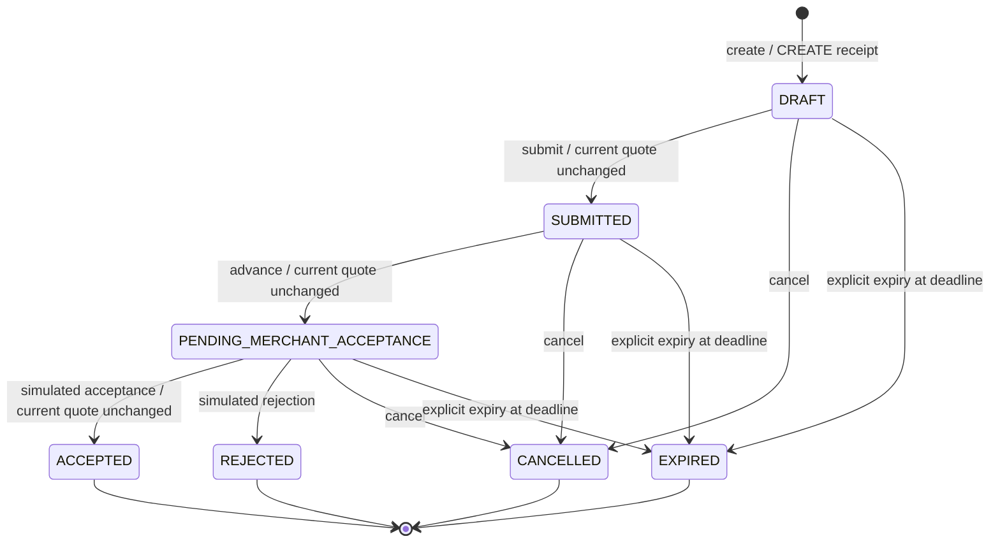

# M07D Customer Order-Intent State Contract

## Contract scope

This is the state contract implemented by `app/CustomerOrders/OrderIntents.php` and migration `037_customer_order_intents.sql`. It governs an internal synthetic intent only. It does not describe the native restaurant order lifecycle and does not authorize public ordering.

## State machine

The arrows describe allowed state changes only. They do not imply a public endpoint or independent merchant-acceptance authority.

| Current state | Allowed next states | Notes |
| --- | --- | --- |
| `DRAFT` | `SUBMITTED`, `CANCELLED`, `EXPIRED` | Submission revalidates quote and catalogue snapshot. |
| `SUBMITTED` | `PENDING_MERCHANT_ACCEPTANCE`, `CANCELLED`, `EXPIRED` | Forward transition revalidates the quote. |
| `PENDING_MERCHANT_ACCEPTANCE` | `ACCEPTED`, `REJECTED`, `CANCELLED`, `EXPIRED` | Acceptance is simulation-only and revalidates the quote. |
| `ACCEPTED` | none | Terminal simulation result. |
| `REJECTED` | none | Terminal simulation result. |
| `CANCELLED` | none | Terminal; no reopening. |
| `EXPIRED` | none | Terminal; no reopening. |

## Authorization on each call

The service first enforces the demo/private feature flags and verifies it owns the database transaction. It validates the customer, merchant, and outlet identifiers, checks customer ownership through `CustomerIdentityProvider` and `CustomerAccounts`, resolves the native staff principal, requires `ReadOrders` for the scoped outlet and `menu:read` entitlement, then locks and rechecks account, staff, membership, outlet mapping, and provider identity inside its `READ COMMITTED` transaction.

Create requires an `ACTIVE` customer account. `SUBMITTED`, `PENDING_MERCHANT_ACCEPTANCE`, `ACCEPTED`, and `REJECTED` transitions require the account to remain active. `CANCELLED` and `EXPIRED` transitions can be performed for the customer's own non-deactivated account, including a suspended account, but still require the current account version, the current trusted identity, and the authorized internal outlet operator. Reads do not require `ACTIVE`, but deny deactivated accounts and still require the two current identities and scoped operator permission.

The code uses the same dual-principal internal simulation authority for all transitions. The state name `PENDING_MERCHANT_ACCEPTANCE` does not create a separate merchant endpoint or a public customer-to-merchant authentication flow.

## Version, duplicate request, and stale request rules

- Create emits version `1` and one `CREATE` receipt.
- Each successful transition must pass `expectedVersion` equal to the stored version; the service increments it once and stores one result receipt for the new version.
- Request IDs are exactly 32 lowercase hexadecimal characters.
- A same-key retry returns the original result only when actor, customer, merchant, outlet, and canonical payload hash match exactly.
- A reused key with a different actor/scope/payload is rejected.
- A distinct request with a stale account or intent version is rejected; it is not treated as a refresh.
- Database uniqueness allows one request receipt globally and one event per intent version. Locks and optimistic version checks serialize competing mutations.
- Reads have no mutation receipt or request key.

## Cancellation and expiration

Cancellation is allowed from each of the three nonterminal states. It is not permitted after a terminal state. A new create is needed for a replacement selection; the original snapshot is not edited or deleted.

Creation sets `expires_epoch` to server time plus 1,800 seconds. There is no scheduler. Expiration must be an explicit `EXPIRED` transition. Before the deadline, `EXPIRED` is rejected. At or after the deadline, the service rejects every non-`EXPIRED` transition; therefore a late cancellation or late forward transition is not accepted. An authorized expiry operation records the terminal status and audit result.

## Quote and audit preconditions

For `SUBMITTED`, `PENDING_MERCHANT_ACCEPTANCE`, and `ACCEPTED`, the service recalculates from the existing customer-eligible catalogue path and compares the complete line snapshot and total with the stored quote. If relevant product/variant revisions, serving, price, eligibility, station/category state, or catalogue fingerprint changed, the transition fails and the caller must create a new reviewed draft. `REJECTED`, `CANCELLED`, and `EXPIRED` preserve the historical quote without requiring it to remain currently orderable.

Every create and successful transition inserts an immutable `SIMULATION` event in the same database transaction as the intent change. A failed event write rolls back the mutation. Reads do not write a state event. Triggers prevent audit/line update or deletion and prevent intent deletion or snapshot/scope/total/original-time mutation.

## Invalid operations

The service rejects, among others:

- Unknown or disallowed state transitions, including any transition out of a terminal state.
- Stale intent/account versions.
- Noncanonical UUIDs or malformed request keys.
- Wrong customer ownership, changed provider identity, revoked membership, missing `ReadOrders`, missing menu entitlement, inactive/missing outlet mapping, or deactivated account.
- Suspended customer creation and forward processing.
- Submission/advancement after expiry or explicit expiry before deadline.
- Changed/unavailable product, serving option, category, station, routing approval, price, or revision on forward transitions.
- Caller-supplied price fields, duplicate selections, invalid quantity, or out-of-bound references.
- Use while required flags are disabled or public/payment/printing flags violate the private simulation boundary.
- Operation inside a transaction owned by the caller.

Underlying PDO failures are allowed to fail the operation; they are not converted to successful receipts. Database triggers and restrictive foreign keys provide an independent integrity boundary.

## Native restaurant-order boundary

`ACCEPTED` is a terminal simulation state only. It does not create a native order ID, payment, KOT, stock movement, usage record, bill, delivery task, or customer notification. Native `StaffPos`, `OrderRepository`, and kitchen services remain the operational authority. Any handoff needs a separately approved state/transaction contract.