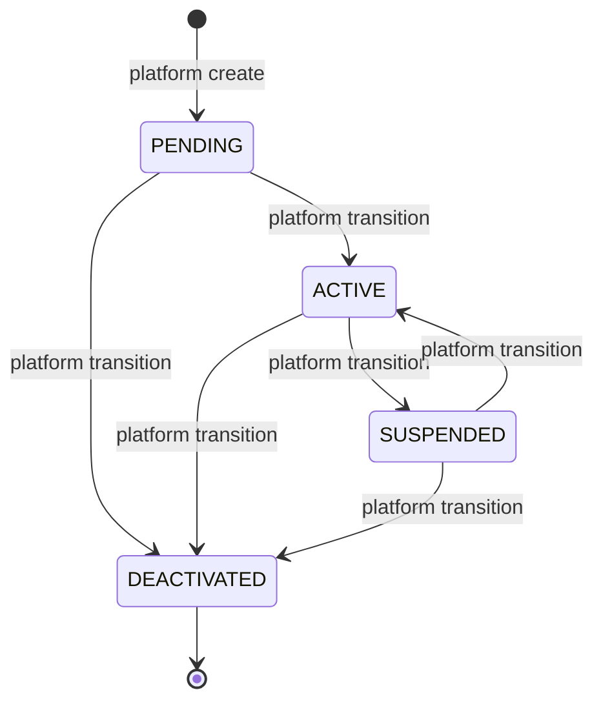

# M07E Partner State Contract

This contract is source-derived from `PartnerAccounts` and migration 038. It covers the current internal synthetic account foundation only; it does not define delivery dispatch states.

## Account lifecycle

| Current status | Allowed next status | Effect |
| --- | --- | --- |
| `PENDING` | `ACTIVE`, `DEACTIVATED` | Creation starts at PENDING, INELIGIBLE, OFFLINE, revision 1. Edges: `PENDING -> ACTIVE`, `PENDING -> DEACTIVATED`. |
| `ACTIVE` | `SUSPENDED`, `DEACTIVATED` | Suspension or deactivation revokes eligibility and sets OFFLINE. Edges: `ACTIVE -> SUSPENDED`, `ACTIVE -> DEACTIVATED`. |
| `SUSPENDED` | `ACTIVE`, `DEACTIVATED` | Reactivation returns to ACTIVE but remains INELIGIBLE and OFFLINE pending a new platform eligibility decision. Edges: `SUSPENDED -> ACTIVE`, `SUSPENDED -> DEACTIVATED`. |
| `DEACTIVATED` | — | Terminal. No outgoing transition is allowed; the account and audit history are retained and owned access is denied. |

There is no direct `PENDING -> SUSPENDED` transition, no reactivation from DEACTIVATED, and no account deletion/reuse. Every allowed lifecycle transition clears eligibility to `INELIGIBLE` and availability to `OFFLINE`. Profile read is allowed to the correctly authenticated owner for PENDING, ACTIVE, and SUSPENDED accounts; mutations require ACTIVE. DEACTIVATED owned access is denied.

## Eligibility and availability

Eligibility is a separate platform-controlled state: `INELIGIBLE` or `ELIGIBLE`. Only an authorized platform administrator can change it, and only for an ACTIVE partner. A successful eligibility change forces availability to OFFLINE. Repeating the current value is rejected.

Availability is a separate partner-controlled state: `OFFLINE`, `AVAILABLE`, or `TEMPORARILY_UNAVAILABLE`. The partner must own the account and be ACTIVE. A transition to AVAILABLE additionally requires ELIGIBLE status and nonempty configured service areas and capabilities. Repeating the current value is rejected. There is no separate availability-transition graph restricting which changed availability value may follow another; these preconditions apply.

Configuration allows up to eight unique `synthetic-area-*` strings and up to two unique capabilities from `synthetic-foot` and `synthetic-cycle`. Configuration changes require an active owner and force OFFLINE. Display-name changes require the `Synthetic ` prefix and the documented bounded character set; they also require ACTIVE ownership.

## Authorization, revision and audit rules

- Creation, account transitions, and eligibility changes require the native `AuthenticatedUserProvider` accepted by `MerchantProvisioner::administer`.
- Profile, display name, configuration, and availability operations require a trusted `PartnerIdentityProvider` resolving to the same partner ID before, during, and before transaction commit.
- Every mutation supplies the expected integer revision. The row is locked and the stored version must equal the expected value; a successful mutation increments exactly once.
- A stale revision, invalid transition, same-state request, unauthorized identity, invalid classification, or unavailable/deactivated account is rejected without a successful mutation event.
- Each successful mutation writes one immutable event at the resulting partner revision. Audit-write failure rolls back the related operation.
- Creation normalizes a unique `synthetic-partner-*` handle and records revision 1. A duplicate handle fails through the unique constraint; there is no request-id deduplication or replay response.

## State contract that does not exist

No states such as ASSIGNED, PICKED_UP, IN_DELIVERY, DELIVERED, CANCELLED, or FAILED exist in this M07E account lifecycle. They must not be inferred from account availability or added to this contract as though implemented. `operationallyEligible` is a simulation projection and `dispatchAuthorized` remains false.
